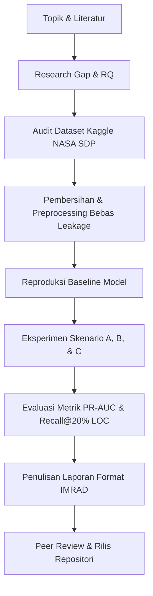
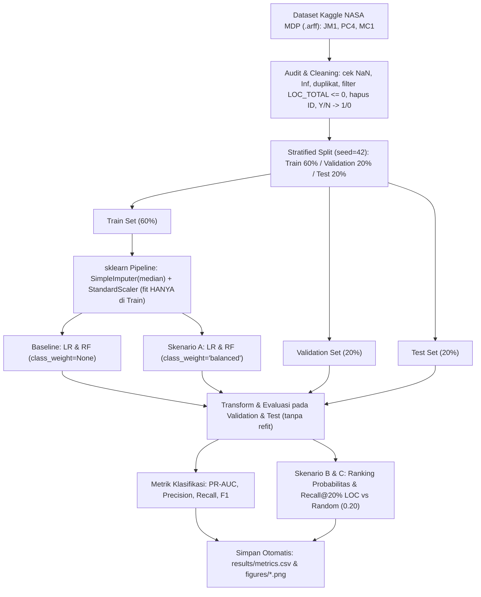

# Cost-Aware Software Defect Prediction Using Static Code Metrics and Machine Learning

Repositori ini merupakan kerangka kerja komputasi dan eksperimen untuk Tugas Akhir mata kuliah Tata Tulis Karya Ilmiah (TTKI) - Topik P3.

## Research Questions & Tujuan
1. **RQ1**: Bagaimana pengaruh penerapan teknik penyeimbangan kelas (*class weighting*) terhadap nilai PR-AUC dan Recall pada model Logistic Regression dan Random Forest?
2. **RQ2**: Bagaimana efektivitas pemeringkatan risiko berbasis probabilitas prediksi model dalam mendeteksi defect pada batas usaha inspeksi 20% total LOC (*Recall@20% LOC*)?

## Alur Kerja Penelitian



### Alur Teknis Eksperimen & Protokol Anti-Leakage



## Sumber Data & Repositori Baseline
- **Dataset**: NASA Software Defect Prediction ([Kaggle Dataset](https://www.kaggle.com/datasets/aczy156/nasa-software-defect-prediction))
- **Baseline Reference**: Repositori GitHub SonamKumari1227 ([Software-Defect-Prediction](https://github.com/SonamKumari1227/-Software-Defect-Prediction))

## Setup Environment

Eksperimen diuji pada **Windows** dengan **Python 3.12** (versi paket lengkap tercatat di `environment-freeze.txt`). Jalankan perintah berikut di terminal:

```bash
# 1. Buat dan aktifkan virtual environment
python -m venv .venv

# Di Windows PowerShell:
.venv\Scripts\Activate.ps1

# Di Linux / macOS:
source .venv/bin/activate

# 2. Instalasi dependensi proyek
pip install -r requirements.txt

# 3. Kunci versi environment
pip freeze > environment-freeze.txt
```

## Urutan Eksekusi Notebook

Setiap eksperimen menggunakan random seed tetap (`random_state=42`), pembagian **Train 60% / Validation 20% / Test 20%** (stratified), serta seluruh tahapan preprocessing (`SimpleImputer` dan `StandardScaler` dalam `Pipeline`) di-fit hanya pada data training:

1. `notebooks/01_eda.ipynb`  
   Audit seluruh 13 file `.arff` NASA MDP di `data/` (deteksi NaN, infinity, duplikat, `LOC_TOTAL <= 0`, rasio class imbalance, ketidaksesuaian skema) dan visualisasi distribusi kelas ke `figures/class_distribution.png`.
2. `notebooks/02_baseline.ipynb`  
   Pelatihan model Logistic Regression dan Random Forest standar (`class_weight=None`) pada varian `JM1`, `PC4`, dan `MC1`, lalu menyimpan metrik Validation & Test ke `results/baseline_metrics.csv`.
3. `notebooks/03_experiment.ipynb`  
   Pengujian skenario class weighting (Skenario A), risk ranking berbasis `predict_proba` (Skenario B), serta evaluasi cost-aware `Recall@20% LOC` vs random baseline `0.20` (Skenario C). Hasil lengkap tersimpan ke `results/metrics.csv` dan grafik (`pr_auc_comparison.png`, `pr_curve.png`, `recall_loc_curve.png`, `recall20_loc_comparison.png`) ke `figures/`.

## Struktur Repositori

```text
ttki-p3-software-defect-prediction/
├── README.md
├── .gitignore
├── requirements.txt
├── data/
│   └── README.md
├── notebooks/
│   ├── 01_eda.ipynb
│   ├── 02_baseline.ipynb
│   └── 03_experiment.ipynb
├── src/
│   ├── __init__.py
│   ├── audit_data.py
│   ├── preprocessing.py
│   └── evaluation.py
├── results/
├── figures/
├── paper/
└── references/
    └── literature_matrix.csv
```

## Lisensi & Atribusi

Proyek ini dikembangkan untuk keperluan akademik dan penelitian ilmiah di bawah lisensi terbuka.
